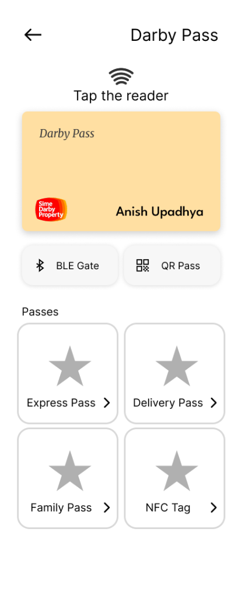

# Darby Pass — Interactive Mobile Prototype

A high-fidelity mobile prototype for **Darby Pass**, a unified smart community access pass for the **Sime Darby Property** resident app ecosystem.

<div align="center">
  
</div>

---

## ⚡ Quick Setup Guide (Get Running in 2 Minutes)

Follow these simple steps to run the prototype on your computer:

### 1. Prerequisites
Make sure you have **Node.js** installed ([Download Node.js](https://nodejs.org/)).

### 2. Install Dependencies
Open your terminal inside this project folder and run:
```bash
npm install
```

### 3. Start the Prototype
```bash
npm run dev
```

### 4. Open in Browser
Click or open: **[http://localhost:5173](http://localhost:5173)**

> 💡 **Best Viewing Experience (Mobile View)**:  
> Press `F12` in your browser (or right-click → **Inspect**), then click the **Mobile Device Icon** (`Ctrl + Shift + M` on Windows or `Cmd + Shift + M` on Mac) and select **iPhone 14/15** or **Pixel 7**.

---

## 📱 How to Open on Your Phone

You can run and test this prototype directly on your smartphone:

1. Make sure your computer and phone are connected to the **same Wi-Fi network**.
2. Look at your terminal output when you run `npm run dev`. It will show your network address, for example:
   ```text
   ➜  Network: http://192.168.0.XX:5173/
   ```
3. Type that URL into Safari (iOS) or Chrome (Android) on your phone.

### Install as a Fullscreen App (PWA):
- **iPhone (Safari)**: Tap the **Share icon** (`⬆`) ➔ tap **"Add to Home Screen"** ➔ tap **Add**.
- **Android (Chrome)**: Tap the **menu (`⋮`)** ➔ tap **"Install app"** or **"Add to Home screen"**.

---

## 🎮 Interactive Features to Try

Every button and card in this prototype is fully clickable:

| Feature | Where to Click | What Happens |
|---|---|---|
| **NFC Card Tap** | Tap the **Digital Card** or **"Tap the reader"** | Triggers an animated pulse ripple and an "NFC Signal Active" confirmation banner. |
| **BLE Boom Gate** | Click **"BLE Gate"** button | Simulates radar scanning and automatically connects to the boom gate to unlock the barrier. |
| **Dynamic QR Pass** | Click **"QR Pass"** button | Shows a dynamic TOTP QR code with a live 30-second progress bar that regenerates automatically. |
| **Express Visitor** | Click **"Express Pass >"** | Generate a single-entry pass for guests (vehicle or pedestrian) with a live countdown timer and WhatsApp share link. |
| **Short-Term Guests** | Click **"Short-Term Guests >"** | Manage multi-day stays (e.g. Airbnb, visiting family), adjust precinct zone permissions, or extend stays. |
| **Delivery Driver** | Click **"Delivery Pass >"** | One-tap provider cards (Grab, Shopee, etc.) that generate a 15-minute time-locked pass with live driver arrival tracking. |
| **Family & Household** | Click **"Family Pass >"** | Set curfew limits, toggle amenity access (pool/gym), and enforce vehicle lockouts for children. |
| **NFC Tags & Keyfobs** | Click **"NFC Tag >"** | Manage linked hardware and walk through an interactive 3-step physical tag pairing sequence. |

---

## 🛠️ Built With

- **React 19** + **Vite** — Fast, modern front-end setup
- **Tailwind CSS v4** — Clean mobile styling matching the original design
- **Framer Motion** — Smooth bottom sheets and interactive transitions
- **Lucide Icons** — Clean icon set
- **Vite PWA** — Offline mobile caching and home screen install

---

## 📄 License & Credits

- Prototype built for **Sime Darby Property** resident ecosystem.
- Released under the [MIT License](LICENSE).
